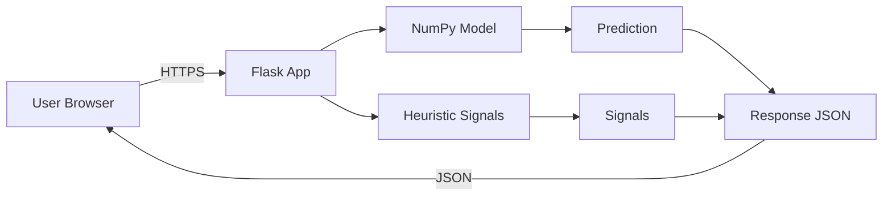

# SpamGuard AI 🛡️

**Check Suspicious Emails Before You Trust Them**

A free, no-registration website where you paste an email subject and body and receive a machine learning prediction, heuristic signals, and safe next steps.

## Features

- 🤖 **ML-Powered Analysis** — Neural network trained on thousands of real emails
- 🔍 **Heuristic Signals** — Pattern-based detection of urgency, prize claims, credential requests, suspicious URLs
- 🔒 **Privacy First** — No registration, no database, no logging of email content
- ⚡ **Instant Results** — Clear verdict with confidence score and actionable steps
- ♿ **Accessible** — WCAG 2.1 AA compliant, keyboard navigable, screen reader friendly
- 💰 **Free** — Open source, no paid tiers

## Architecture



**Training:** TensorFlow/Keras → Export weights → NumPy arrays
**Serving:** NumPy-only forward pass (no TensorFlow in production)

## Prerequisites

- Python 3.11+ (3.14 supported)
- pip
- Git
- Docker Desktop (for container testing)

## Quick Start (Windows PowerShell)

```powershell
# Clone the repo
git clone https://github.com/jagapathi518/email_spam_detection_ML.git
cd email_spam_detection_ML

# Create virtual environment
python -m venv venv
.\venv\Scripts\Activate.ps1

# Install dependencies (development)
pip install -r requirements-dev.txt

# Download dataset
python scripts/get_data.py

# Train the model
python ml/train.py

# Run parity gate
python ml/parity.py

# Run tests
pytest

# Lint
ruff check .
ruff format --check .

# Start local server
python wsgi.py
# Visit http://localhost:5000
```

## API Reference

### `GET /api/health`

```powershell
Invoke-RestMethod -Uri "http://localhost:5000/api/health"
```
```bash
curl http://localhost:5000/api/health
```

Response:
```json
{"status": "ok", "model_loaded": true}
```

### `POST /api/predict`

```powershell
$body = @{subject="URGENT"; body="You have won a prize"} | ConvertTo-Json
Invoke-RestMethod -Uri "http://localhost:5000/api/predict" -Method POST -Body $body -ContentType "application/json"
```
```bash
curl -X POST http://localhost:5000/api/predict \
  -H "Content-Type: application/json" \
  -d '{"subject": "URGENT", "body": "You have won a prize"}'
```

Response:
```json
{
  "label": "spam",
  "score": 0.9234,
  "model_version": "v1",
  "thresholds_version": "v1",
  "signals": [
    {"id": "urgency_language", "name": "Urgency Language", "description": "...", "severity": "warning"},
    {"id": "prize_financial", "name": "Prize or Financial Claim", "description": "...", "severity": "danger"}
  ],
  "disclaimer": "This analysis is provided by an automated system..."
}
```

### `GET /api/model-info`

```powershell
Invoke-RestMethod -Uri "http://localhost:5000/api/model-info"
```

## Deployment

See [DEPLOYMENT.md](DEPLOYMENT.md) for step-by-step Render deployment instructions.

## Testing

```powershell
# Unit tests
pytest tests/ -v

# Smoke test (against running server)
python scripts/smoke_test.py http://localhost:5000

# Lint
ruff check .
ruff format --check .
```

## Project Structure

```
├── app/                  # Flask application
│   ├── create_app.py     # App factory
│   ├── routes.py         # API + page routes
│   ├── services.py       # Model service
│   ├── signals.py        # Heuristic signal catalog
│   ├── static/           # CSS, JS, images
│   └── templates/        # HTML templates
├── ml/                   # ML pipeline
│   ├── tokenizer.py      # Shared tokenizer (Python/NumPy)
│   ├── data.py           # Email parsing
│   ├── train.py          # Training pipeline
│   ├── export.py         # NumPy forward pass
│   └── parity.py         # Parity gate
├── models/v1/            # Trained model artifacts
├── tests/                # pytest test suite
├── scripts/              # Utility scripts
├── docs/                 # Documentation
├── Dockerfile            # Production container
├── render.yaml           # Render Blueprint
└── wsgi.py               # WSGI entry point
```

## Known Limitations

1. **Training data age** — Model trained on Apache SpamAssassin corpus (early 2000s). May miss modern phishing.
2. **Text only** — Does not analyze headers, attachments, SPF/DKIM/DMARC, or sender reputation.
3. **Not a safety guarantee** — This tool provides best-effort analysis, not a guarantee.
4. **Free-tier hosting** — Server may take ~1 minute to wake up after inactivity.
5. **Rate limited** — Counters reset on server restart; multi-instance requires Redis.

## Troubleshooting

| Problem | Solution |
|---------|----------|
| `ModuleNotFoundError` | Activate venv: `.\venv\Scripts\Activate.ps1` |
| TensorFlow install fails | Use Python 3.11; or see WSL2 fallback in DECISIONS.md |
| Port already in use | Set `PORT=5001` environment variable |
| Cold start slow | Normal for free tier; first request wakes the server |
| Tests fail on model load | Run `python ml/train.py` first to create model artifacts |

## License

This project is for educational purposes. The Apache SpamAssassin corpus is freely available for research use.
